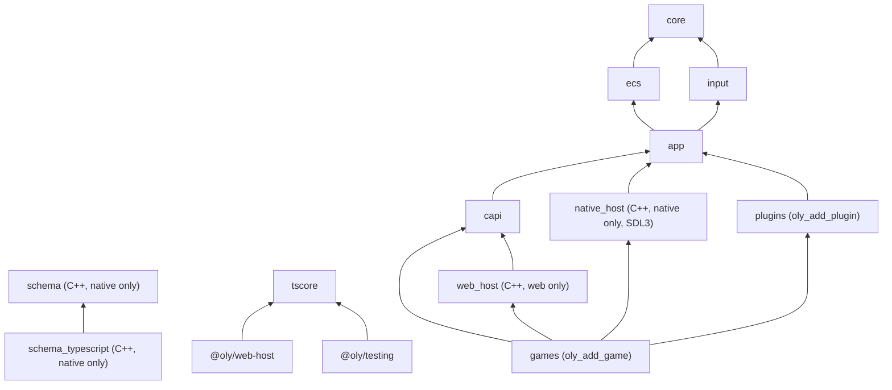

# Modules and boundaries

## Dependency graph

| Module | CMake target | `DEPENDS` | Type |
|---|---|---|---|
| `core` | `oly::core` | — | library |
| `ecs` | `oly::ecs` | `core` | library |
| `input` | `oly::input` | `core` | library |
| `app` | `oly::app` | `input ecs core` | library |
| `capi` | `oly::capi` | `app input ecs core` | `OBJECT` |
| `web_host` | `oly::web_host` | `capi` | `OBJECT`, built only with Emscripten |
| `native_host` | `oly::native_host` | `app input ecs core` + SDL3 | library, built only with `OLY_BUILD_NATIVE_HOST` |
| `schema` | `oly::schema` | — | `STATIC`, native builds only |
| `schema_typescript` | `oly::schema_typescript` | `schema` | `OBJECT`, native builds only |

A **plugin** (`oly_add_plugin`, [plugins.md](../../architecture/plugins.md)) is a `STATIC` target `oly::<name>` that links the modules of its `DEPENDS` and the plugins of its `PLUGINS`. A game links the plugins it turns on and their dependencies. Plugins depend on the core; nothing in `engine/` depends on a plugin under `plugins/`. The plugins today are `essentials2d` and `essentials3d` in `plugins/`, and two test plugins that belong to the engine, in `engine/testing/fixture/plugins/`:

| Plugin | CMake target | `DEPENDS` | `PLUGINS` |
|---|---|---|---|
| `essentials2d` | `oly::essentials2d` | `ecs app core` | — |
| `essentials3d` | `oly::essentials3d` | `ecs app core` | — |
| `counting` (test) | `oly::counting` | `ecs app` | — |
| `doubling` (test) | `oly::doubling` | `ecs app` | `counting` |

`capi` and `web_host` are `OBJECT` because, in a static library, the linker would discard the unreferenced members and take the `EMSCRIPTEN_KEEPALIVE` functions with them.

`native_host` depends on `app`, never on `capi`: a C++ game and a C++ host use `oly::app::Engine` directly. It links SDL3 statically and `PUBLIC`, so a game's drawing code can include `<SDL3/SDL.h>`.

The C API headers, `oly/capi/c_api.h` and `oly/capi/engine_api.h`, are valid C11 and C++20: `capi.foreign_client` is a `.c` file that includes only them.

## How the boundaries are enforced

The boundaries do not hold by convention alone. Three mechanisms enforce them:

1. **The build.** `oly_add_module(NAME <m> DEPENDS <...>)` links only the declared modules. `ecs` does not link `capi`, so an include of `capi` inside the ECS does not compile. `oly_add_plugin` does the same with `DEPENDS` and `PLUGINS`.
2. **The `oly.lint.boundaries` lint** (`tools/check_boundaries.py`, runs in ctest, with a self-test in `oly.lint.boundaries_selftest`). Its manifest lists modules, plugins and games with their dependencies. Dependencies are `PUBLIC` and transitive, so the build accepts an include of a module that is only a dependency of a dependency, and only the lint catches the undeclared direct include. The rules are in [Boundary rules](../../reference/contributor/boundary-rules.md).
3. **The TS surface test** (`ts.core.unit`, `surface.test.ts`). It checks the public exports of `@oly/core` against the versioned list `engine/environments/web/clients/typescript/core/api/public-exports.txt`. Adding something to the public API is an explicit change in that file.

Why `detail/` and a lint, and not pimpl: the hot-path templates (`Query<Ts...>::each`, `World::get<T>`, `World::spawn<Ts...>`) need to see `Table` and `Archetype` to inline. Hiding these types behind pimpl or a virtual interface would put indirection in the iteration loop. The compiler sees the details; the build rejects whoever uses them from outside.

## Vocabulary rules

- Game concepts (enemy, coin, dash) never enter `engine/`. Game names only appear in `engine/testing/fixture/`, never in `plugins/`.
- The same verb holds across the three surfaces (C++, C API, TS): `spawn`, `destroy`, `add`, `remove`, `has`, `get`, `query`, `eachBlock`. The full glossary is in [Glossary](../../reference/glossary.md).
- The `oly` prefix appears only in the C API (`oly*`, `OlyWorld`, `OLY_API`) and in what is internal to `capi`. `extern "C"` symbols live in a single global namespace of the WASM module, together with libc and the game's exports; the prefix avoids collisions. The C++ (`oly::ecs::World`) and TS (`World`) APIs do not repeat `oly`.
- The `ById` suffix marks the variant by `ComponentId` at run time: `addById`, `removeById`, `hasById`, `getById`, `tryGetById`, `queryById`.
